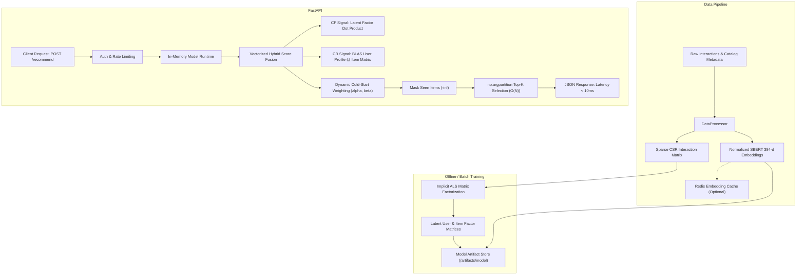

# System Architecture: Hybrid Recommendation Engine

## 1. Executive Summary

The **Hybrid Recommendation Engine** is an enterprise-grade recommendation system designed for low-latency inference, dynamic cold-start mitigation, and high catalog discovery. It combines **Collaborative Filtering (Implicit ALS / Matrix Factorization)** with **Content-Based Semantic Embeddings (Sentence-Transformers / SBERT)**.

## 2. Key Mathematical Formulations

### 2.1. Collaborative Filtering (Implicit ALS)
Given an implicit interaction matrix $\mathbf{R} \in \mathbb{R}^{U \times I}$, confidence values are defined as:
$$c_{ui} = 1 + \alpha r_{ui}$$
The objective minimizes:
$$\mathcal{L} = \sum_{u, i} c_{ui} \left( p_{ui} - \mathbf{x}_u^T \mathbf{y}_i \right)^2 + \lambda \left( \sum_u \|\mathbf{x}_u\|_2^2 + \sum_i \|\mathbf{y}_i\|_2^2 \right)$$
For online scoring, raw predictions are mapped to $[0, 1]$ using a calibrated sigmoid:
$$\hat{s}_{\text{CF}}(u, i) = \sigma(\mathbf{x}_u^T \mathbf{y}_i) = \frac{1}{1 + e^{-\mathbf{x}_u^T \mathbf{y}_i}}$$

### 2.2. Content-Based Semantic Embeddings
Catalog text items (Title + Description) are encoded into 384-dimensional dense semantic vectors using `all-MiniLM-L6-v2`:
$$\mathbf{v}_i = \frac{\text{SBERT}(\text{text}_i)}{\|\text{SBERT}(\text{text}_i)\|_2}$$
A user's profile $\mathbf{u}_u$ is constructed dynamically as the rating-weighted centroid of their interacted items:
$$\mathbf{u}_u = \frac{\sum_{i \in \mathcal{I}_u} r_{ui} \mathbf{v}_i}{\left\| \sum_{i \in \mathcal{I}_u} r_{ui} \mathbf{v}_i \right\|_2}$$
Vectorized content scores across all catalog items are computed in a single BLAS matrix-vector product:
$$\hat{\mathbf{s}}_{\text{CB}}(u) = \frac{\mathbf{V}_{\text{items}} \cdot \mathbf{u}_u + 1}{2}$$

### 2.3. Dynamic Cold-Start Weight Adaptation
Rather than using static weights, the engine dynamically balances Collaborative ($\alpha$) and Content-Based ($\beta$) weights per user interaction density:
- **Zero Interactions (Cold User)**: $\alpha = 0.10, \beta = 0.90$ (Semantic matching dominates).
- **Sparse Interactions (< 3)**: $\alpha = 0.25, \beta = 0.75$.
- **Established User ($\ge 15$)**: $\alpha = 0.70, \beta = 0.30$ (Collaborative patterns dominate).

$$\text{Score}_{\text{Hybrid}}(u, i) = \alpha_u \hat{s}_{\text{CF}}(u, i) + \beta_u \hat{s}_{\text{CB}}(u, i)$$

## 3. High-Performance Serving Guarantees
- **Vectorized Top-K**: Instead of sorting the entire catalog in Python loops ($O(N \log N)$), the engine uses `np.argpartition` ($O(N)$) to select top candidates before sorting only the top $K$.
- **BLAS Acceleration**: Matrix operations are offloaded to optimized OpenBLAS/MKL routines.
- **Asynchronous Non-Blocking API**: FastAPI threadpool execution ensures CPU-intensive scoring never blocks health probes or the asyncio event loop.
